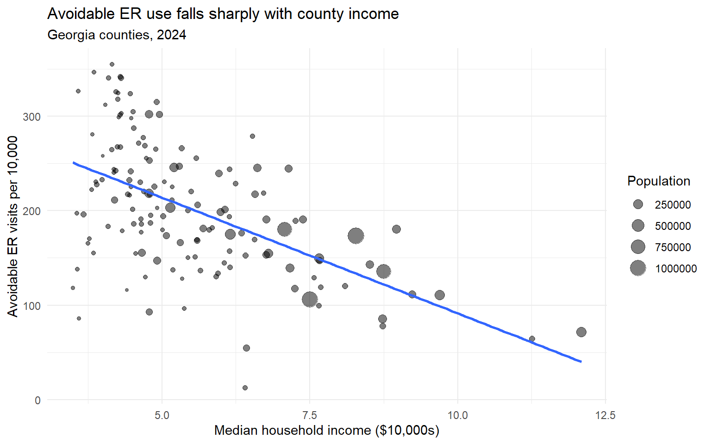
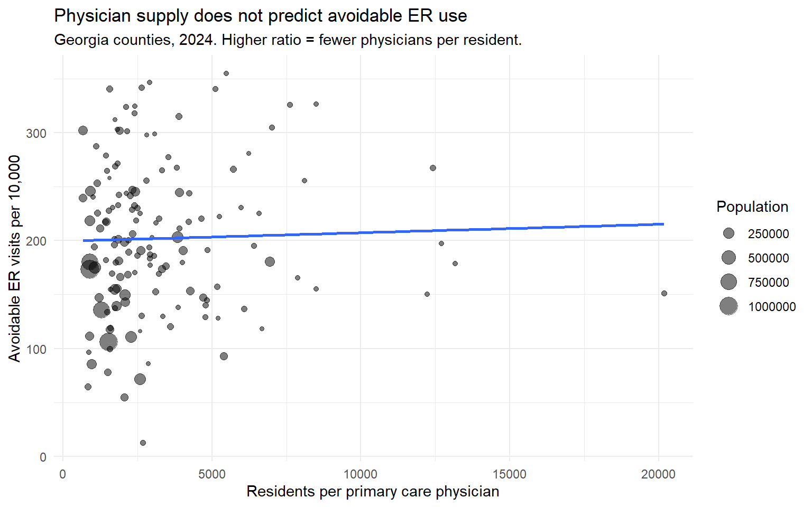

# Avoidable Emergency Department Use in Georgia

**County-level predictors of ambulatory care sensitive ER visits, 2019–2025**

📄 **[Read the full report](https://awiqar.github.io/georgia-avoidable-ed/analysis.html)** (rendered R Markdown, with code)

📊 **[Explore the interactive dashboard](https://public.tableau.com/app/profile/ahmed.wiqar/viz/AvoidableERUseinGeorgia/AvoidableERUse)** (Tableau Public)

---

## Question

Ambulatory care sensitive conditions (ACSCs) are conditions where good outpatient care should keep people out of the emergency department. High ACSC ER rates are usually read as a sign of unmet primary care need.

**Which Georgia counties have the highest rates of avoidable ER use, and does that variation track with primary care physician supply?**

## Key findings

- **Income, not physician supply, predicts avoidable ER use.** Each additional $10,000 of county median household income is associated with **25.8 fewer** avoidable ER visits per 10,000 residents (p < 0.001), about 15% of the statewide average rate.
- **Primary care physician supply shows no association**, either on its own (r = 0.03) or after controlling for income, insurance coverage and rurality. That holds across a thirtyfold range, from 670 to 20,171 residents per physician.
- **The measure has a geographic blind spot.** Border counties near Chattanooga and Jacksonville undercount because residents use out-of-state hospitals. Remote counties far from any ER understate need rather than show its absence.
- **The pandemic dip has not fully recovered.** The statewide rate fell from 178.2 per 10,000 (2019) to 136.1 (2020), and was still below baseline at 167.4 in 2025.

<p align="center">
  
  
</p>

## Data

| Source | Content | Years |
|---|---|---|
| [Georgia DPH OASIS](https://oasis.state.ga.us/) | ER visits by county and cause (Georgia hospitals only) | 2019–2025 |
| [Georgia DPH OASIS](https://oasis.state.ga.us/) | County population (intercensal estimates) | 2019–2025 |
| [County Health Rankings](https://www.countyhealthrankings.org/) | PCP ratio, % uninsured, % rural, median income | 2023 release |

The analysis covers six ACSC categories: diabetes, hypertension, hypertensive heart disease, hypertensive heart and chronic kidney disease, pneumonia and asthma.

## Approach

1. **Import and reshape:** OASIS exports wide (one column per year) with subtotal rows built in. The pipeline pivots to long format and drops the aggregate rows.
2. **Validate at every step:** row counts are checked against expected dimensions (159 counties × 6 causes × 7 years = 6,678). This check caught a mislabelled statewide "County Summary" row that visual inspection missed. Join keys are checked with `setdiff()` before each join, and `stopifnot()` guards confirm that no join changes the row count.
3. **Compute rates:** ACSC visits per 10,000 residents by county and year.
4. **Model:** a cross-sectional OLS on 2024 data (n = 146 counties). Thirteen counties with no primary care physician on record are excluded rather than imputed. The report includes residual diagnostics and an inspection of the largest residuals.

## Repository structure

```
├── analysis.Rmd          # full analysis: import → cleaning → validation → model
├── analysis.html         # knitted report (served via GitHub Pages)
├── data/
│   ├── raw/              # source exports from OASIS and County Health Rankings
│   └── clean/            # analysis-ready CSVs written by analysis.Rmd
├── figures/              # key charts used in this README
├── tableau/              # Tableau-ready extracts behind the dashboard
└── georgia-avoidable-ed.Rproj
```

## Reproducing the analysis

Requires R (≥ 4.1) and these packages:

```r
install.packages(c("readxl", "dplyr", "tidyr", "stringr", "readr", "ggplot2", "rmarkdown"))
```

Then open `georgia-avoidable-ed.Rproj` in RStudio and knit `analysis.Rmd`. All paths are relative to the project root.

## Limitations

- Covers Georgia hospital discharges only. Care at out-of-state and military facilities is not captured.
- County characteristics come from a single year (2023) and are treated as static.
- The six OASIS ACSC categories are narrower than the full AHRQ Prevention Quality Indicator set.
- The analysis is cross-sectional, so no causal claim is made.

## Further work

- Measure distance to the nearest ER, including out-of-state facilities, to test the cross-border hypothesis directly.
- Stratify by payer (self-pay, PeachCare).
- Build a panel model with county fixed effects to use the full seven-year window.

---

**Author:** Ahmed Wiqar
